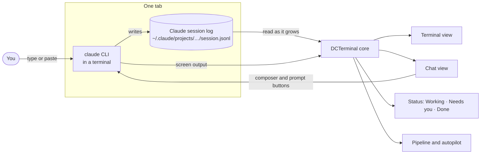
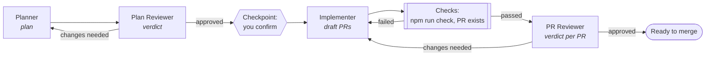

# DCTerminal

**A desktop workspace for running Claude Code (and Cursor CLI) agents side by side, one role per tab.**

Plan, review, implement and review the PR in a chain of tabs, with hand-offs that carry each role's result into the next one. Every tab runs the real `claude` CLI, and you can read the same session as a terminal or as a chat. Built with Tauri 2, React and Rust. Runs on macOS, Linux and Windows.

> **Status:** pre-MVP, personal tool, version 0.1.0. See [docs/MVP-FINISH.md](docs/MVP-FINISH.md) for what "done" means.

---

## Contents

- [Features](#features)
- [How it works](#how-it-works)
- [Install](#install)
- [Set up Claude Code](#set-up-claude-code)
- [Opening a tab](#opening-a-tab)
- [The role pipeline](#the-role-pipeline)
- [Keyboard shortcuts](#keyboard-shortcuts)
- [Development](#development)
- [Troubleshooting](#troubleshooting)
- [Project layout](#project-layout)
- [Docs](#docs)

---

## Features

| | |
|---|---|
| **Terminal first** | **Ctrl+T** opens a terminal straight away: Claude here, a shell, a role, or a recent project. Choose what a new tab does under **Settings › Terminal › New tab opens**. |
| **Terminal or Chat view** | A Claude terminal tab has a **Terminal · Chat** switch. Chat shows the same session, read from Claude's own session log, with a composer that types into the terminal and buttons for permission prompts. Nothing restarts when you switch. |
| **Roles** | Planner, Plan Reviewer, Implementer, PR Reviewer, and more. Each one has its own prompt, color, model and permission mode. Edit roles, add your own, or open any role from the launcher (**Ctrl+Alt+R**). |
| **Hand-offs and autopilot** | **Send to …** passes a finished role's result to the next role's form. Pipelines can loop back for review rounds, run checks between stages, and run on autopilot in terminal tabs. |
| **Truthful status** | Every tab shows **Working**, **Needs you**, **Done** or **Exited**, plus how many sub-agents are running. It also sends a notification when Claude waits on you or finishes. |
| **See the run** | The chain overview draws each stage's rounds, waits, checks and sub-agents on one time axis. Pipeline tabs can dock the run's plan beside the terminal. |
| **Scratch pad** | Draft long prompts under any session. A `---` line splits the pad into steps that send one after another. Large pastes get an offer to strip colours and fold repeated lines. |
| **Split and grid** | Show a second tab live beside the current one, or watch up to six tabs in a grid. Each pane has a strip with its role, folder, branch and status. |
| **Files, Changes, Activity** | Browse and edit files, with Markdown and Mermaid diagrams rendered. File paths in terminal output are links. Review the git diff, and see every command and file write an agent made. |
| **Themes** | GitHub Dark and Light, Dracula, Nord, Tokyo Night and Catppuccin Mocha, plus your own colours. Inter and JetBrains Mono are bundled, so the app looks the same everywhere. |
| **Localhost preview** | Watch your dev server in a tab next to the agent working on it. Only `localhost` pages load inside the app. |
| **GitHub monitor** | A tab that shows pushes, PRs, merges, reviews, comments, branches and releases in the repos you watch, with a "Needs you" list. Read-only, and read through your `gh` login. |
| **Your data stays local** | Transcripts, roles and settings live in the app data folder. GitHub is read through your own `gh` login, so DCTerminal never sees the token. Nothing else leaves your machine. |

## How it works

Each tab runs the real Claude Code CLI in a terminal. DCTerminal reads Claude's own session log to know what happened, so the terminal view, the chat view, the tab status and the pipeline all see the same thing.



DCTerminal only reads Claude's config folder. It never writes there.

## Install

One command builds DCTerminal for this computer and installs it. It needs Node 20+ and Rust. The script checks both and asks before installing anything.

```bash
./install.sh            # macOS or Linux
npm run install-app     # any OS, including Windows
```

```powershell
# Windows (PowerShell 5.1 or 7)
powershell -NoProfile -ExecutionPolicy Bypass -File .\install.ps1
```

To update, quit the app, run `git pull`, then run the installer again.

<details>
<summary>Installer options, and where things go</summary>

| Flag | Effect |
|---|---|
| `--yes` | Answer yes to every prompt |
| `--skip-checks` | Skip `npm run check` before building |
| `--universal` | macOS: build for Apple Silicon and Intel |
| `--uninstall` | Remove the app, keep your data |

| OS | App | Your data (kept on uninstall) |
|---|---|---|
| macOS | `/Applications/DCTerminal.app` (or `~/Applications`) | `~/Library/Application Support/com.jtfrancisco.dcterminal/` |
| Linux (apt) | `/usr/bin/dcterminal` | `~/.local/share/com.jtfrancisco.dcterminal/` |
| Linux (no apt) | `~/.local/bin/DCTerminal.AppImage` | `~/.local/share/com.jtfrancisco.dcterminal/` |
| Windows | `%LOCALAPPDATA%\DCTerminal\dcterminal.exe` | `%APPDATA%\com.jtfrancisco.dcterminal\` |

The build has no code signing and no CI release. See [docs/RELEASE.md](docs/RELEASE.md).
</details>

## Set up Claude Code

Claude is the default provider. Terminal tabs run `claude`. The older chat tabs use the ACP adapter.

```bash
# 1. Install Claude Code: https://code.claude.com  (macOS: brew install --cask claude-code)
# 2. Sign in with your own subscription
claude      # then /login
# 3. Optional, only for ACP chat tabs: install the adapter
npm install -g --omit=optional @agentclientprotocol/claude-agent-acp@0.88.0
```

- **Second account:** point **Settings › Providers › Claude config folder** at it (for example `~/.claude-account2`), or set `DCT_CLAUDE_CONFIG_DIR` before launch. DCTerminal only reads that folder.
- **Cursor CLI (optional):** install it and run `agent login`.

## Opening a tab

**Ctrl+T** asks what to open. The folder comes from the active tab, then your latest project, then your home folder.

```
┌ New tab ──────────────────────────────── esc ┐
│ ▸ C  Claude here       ~/code/acme-api   ↵    │
│   S  Shell here        ~/code/acme-api        │
│   R  Role…             Planner, Implementer…  │
│   G  GitHub            Pushes, PRs and reviews│
│ ── Recent projects ────────────────────────── │
│   1  acme-web          ~/code/acme-web        │
│   2  DCTerminal        ~/Documents/Projects/… │
│   O  Open folder…                             │
│ ☐ Don't ask again: always open Claude here    │
└───────────────────────────────────────────────┘
```

| Setting: New tab opens | Ctrl+T does |
|---|---|
| **Ask** (default) | Shows the picker above |
| **Claude** | Starts `claude` in the folder straight away |
| **Shell** | Starts your shell in the folder |
| **Start screen** | Shows the full start form |

**Role…** (or **Ctrl+Alt+R** anywhere) opens the role launcher. Search for a role, pick Claude or Cursor, then **Terminal** (the default) or Chat. Autopilot needs Terminal.

## The GitHub tab

**G** in the picker, or **Open GitHub** in the command palette, opens the GitHub tab. A window has at most one: opening it again switches to it. It works in split view and the grid beside an agent terminal, and it is saved with workspaces.

It is a monitor. It reads GitHub and never writes to it: no merging, approving, commenting or marking notifications read.

- **Needs you** lists PRs where your review is requested, your PRs that were merged or closed, and new comments on your PRs.
- **Activity** is a feed, newest first, of pushes, PRs opened, merged and closed, reviews, comments, branches and releases. Click a row to open it on GitHub. A push row expands to load its commits.
- **Filters**: All, koneksi-tech or Mine; one repo; event types; **Involves me**; and **Show bots**, which is off by default, so Dependabot and similar accounts stay out of the way.
- **Notifications** (under your existing notification setting) fire once, across all windows, for a review request, your merged or closed PR, or a new comment on your PR. Bot activity never notifies, and the first sync only notes what was already there.

**Setup.** The tab runs the `gh` CLI, so install it and run `gh auth login`. The token needs the `repo` scope. If `gh` is missing, signed out or short on scope, the tab says how to fix it. A repo that can no longer be reached gets a notice and the rest keeps updating.

**What is watched.** The seven repos listed under `watched` in `github.json` (in the app data folder) in the `koneksi-tech` org, plus every repo your `gh` account owns. Edit `watched` to change the list; there is no UI for it yet. Other orgs and the activity of people you follow are never shown. Per-repo feeds reach back as far as GitHub keeps them (up to 300 events per repo), and the tab says how far.

**Polling.** Only while the window has a GitHub tab: every minute while the tab is visible, every five minutes otherwise, and no faster than GitHub's `X-Poll-Interval`. Unchanged replies (HTTP 304) cost no rate limit. It pauses when the rate limit is nearly used up.

## The role pipeline



1. Start a **Planner** tab: pick a folder and the role, then describe the task.
2. When its turn ends, press **Send to Plan Reviewer**. The plan fills the next role's fields. Check the preview and press Start.
3. Repeat down the chain. When a reviewer asks for changes, **Send back to …** returns the findings to the earlier tab as a new round. There is no round limit when you send back yourself; autopilot stops at a pipeline's round cap, if it sets one.
4. Use **Open chain overview…** to see every stage on a time axis, with its status, verdict and checks.

**Autopilot** is off by default. Turn it on for one run in the chain overview, and the run moves on by itself after each turn. A Rust run actor drives it: each stage's `claude` reports its turn end and result through the pipeline bridge (hooks and a `submit_result` tool), so nothing is guessed from the screen or the reply. Autopilot types no keystrokes, except a single paste into a stage that has no saved Claude session yet. Stages run hidden; open one's tab or **Watch** it, and **Take over** to type in it. A round sent back resumes the earlier stage's Claude session. It stops when Claude needs you, at the checkpoint before the Implementer, when a check keeps failing, when a stage reports no result, or when your Claude usage limit is near. Review rounds go back until the reviewer approves, unless a pipeline sets a round cap. It never merges a pull request. Autopilot drives terminal tabs only.

Runs started before pipeline v2, and runs of a pipeline with parallel reviewers or a stage that is not a planner, reviewer or implementer (by stage kind, so a copied role counts like its original), are **manual only**: the overview says so, and you hand each stage on yourself.

Terminal roles launch Claude Code in `plan` mode (Planner) or `auto` mode (the others), so Claude still asks before risky actions. Those questions show up as **Needs you**, and in Chat view as buttons.

**How to reply to each role:** see [docs/PIPELINE-REPLY-GUIDE.md](docs/PIPELINE-REPLY-GUIDE.md). Pipelines are data: see [docs/pipelines/README.md](docs/pipelines/README.md) to define your own.

## Keyboard shortcuts

Use ⌘ in place of Ctrl, and Option in place of Alt, on macOS. **Ctrl+/** shows the full list for your platform, and **Ctrl+K** runs any action by name. Buttons show their own shortcut.

| Keys | Action | Keys | Action |
|---|---|---|---|
| `Ctrl+K` | Command palette | `Ctrl+P` | Go to tab |
| `Ctrl+T` / `Ctrl+W` | New / close tab | `F6` | Reopen closed tab |
| `Ctrl+Alt+R` | New tab with a role | `Ctrl+Alt+C` | Switch Chat / Terminal view |
| `Ctrl+1…9` | Go to tab | `F2` | Rename tab |
| `Ctrl+Enter` | Send | `Ctrl+.` | Scratch pad → input |
| `Ctrl+J` / `Ctrl+L` | Focus pad / input | `Ctrl+F` | Find in tab |
| `Ctrl+\` / `Ctrl+Alt+\` | Split right / down | `Ctrl+Alt+G` | Grid view |
| `Ctrl+B` | File panel | `Ctrl+=` / `Ctrl+-` / `Ctrl+0` | Terminal text size |
| `Ctrl+,` | Settings | `Esc` | Back to terminal / close dialog |

In terminal tabs, Option works as Meta for Claude Code's Option shortcuts, and Shift+Enter adds a new line. You can turn Option as Meta off under **Settings › Terminal**. On Linux and Windows, `Ctrl+Alt+C` and `Ctrl+Alt+R` go to the shell while a terminal has focus, so use the command palette there.

## Development

```bash
npm install
npm run dev:ui      # terminal 1: Vite, leave running (React/CSS hot-reload)
npm run dev:app     # terminal 2: the desktop app (restarts on Rust changes)
```

`npm run dev:full` does both in one terminal. `npm run dev:ui` alone is browser-only and can't call Rust commands.

The app runs under a content security policy (`src-tauri/tauri.conf.json`). Tauri applies it only to the built frontend, so the hot-reload setup above runs without it. To test with the policy, use `npm run dev:stable`.

**Before merging, run:**

```bash
npm run check       # cargo test, clippy -D warnings, vitest, build
```

| Command | What it does |
|---|---|
| `npm test` | Unit tests (vitest), including a check that every IPC call matches a Rust command |
| `npm run e2e:ui` | Playwright UI tests against a fake backend (slow) |
| `npm run build:roles` | Rebuild `seed/roles.seed.json` from `docs/roles/*.md`, then rebuild the app (the seed is compiled in) |
| `npm run release:mac` / `:linux` / `:win` | Build installers without installing |

**Requirements:** Node 20+, Rust 1.90+, the [Tauri prerequisites](https://tauri.app/start/prerequisites/), and WebView2 on Windows (usually preinstalled). GitHub Actions is off, so `npm run check` is the gate.

## Troubleshooting

| Symptom | Fix |
|---|---|
| Blank window | Use two terminals (`dev:ui` + `dev:app`), or `npm run dev:stable` |
| Port 1420 in use | Stop other `vite`/`tauri` processes, or keep one `dev:ui` and restart only `dev:app` |
| Windows: `cargo metadata` / `program not found` | Rust isn't on PATH. Open a new terminal, or add `%USERPROFILE%\.cargo\bin` to Path |
| Tab shows **Needs you** | Claude is waiting on a permission prompt, question or plan. Answer it in the tab, or with the buttons in Chat view |
| "Couldn't confirm — check the terminal" | A prompt button's key may not have reached Claude Code. Switch to Terminal and answer there |
| **Needs you** stops showing after a Claude Code update | Prompt detection reads Claude Code's screen layout (pipeline stages on engine 2 also hear it from Claude Code's PermissionRequest hook). Answer in the terminal, and report the version |
| Localhost preview is blank | The dev server forbids framing (X-Frame-Options or CSP `frame-ancestors`). Use **Open in browser** |
| "Not authenticated" | `claude` then `/login` (or `agent login` for Cursor), then Start again |
| The app closed unexpectedly | Details are in `logs/crash.log` in your data folder. **Settings › Data** shows the path |
| `Chrome_WidgetWin_0` on exit | Harmless WebView2 message |

## Project layout

| Path | What's there |
|---|---|
| `src/` | React UI (`views/`, `components/`, `terminal/`, `handoff/`, `pipeline/`, `preview/`), IPC in `bridge.ts` |
| `src-tauri/` | Rust core: PTY, session-log reader (`claude_session_log/`), ACP, providers, pipelines, stores |
| `docs/roles/` | Role prompts (source of truth) |
| `docs/pipelines/` | Built-in pipeline definitions |
| `seed/` | Generated built-in roles, compiled into the app |
| `e2e/` | Playwright UI tests and the fake-agent harness |
| `fixtures/` | Recorded ACP sessions and terminal captures |
| `docs/` | Plans, guides, ADRs |

## Docs

| Doc | For |
|---|---|
| [PIPELINE-REPLY-GUIDE.md](docs/PIPELINE-REPLY-GUIDE.md) | Getting clean hand-offs from each role |
| [pipelines/README.md](docs/pipelines/README.md) | Pipeline format: stages, loop-backs, checks, checkpoints |
| [ADR-014](docs/adr/014-pipeline-engine-opt-in-autopilot.md) | Why the pipeline engine and autopilot work the way they do |
| [RELEASE.md](docs/RELEASE.md) | Building and releasing installers |
| [TESTING.md](docs/TESTING.md) | Test layers and how to run them |
| [DCTerminal-Project-Blueprint.md](docs/DCTerminal-Project-Blueprint.md) | Full product spec |
| [MVP-FINISH.md](docs/MVP-FINISH.md) · [PROGRESS.md](docs/PROGRESS.md) · [TASKS.md](docs/TASKS.md) | Status and checklists |
| [permission-payload-capture.md](docs/permission-payload-capture.md) | Recording permission payloads |
| [cursor-cli-history.md](docs/cursor-cli-history.md) | Cursor CLI session history and resume |

---

Private, personal tool.
