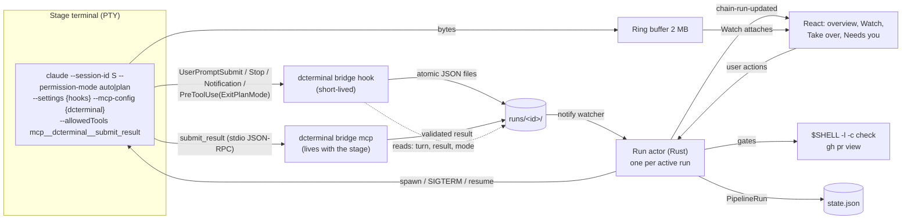
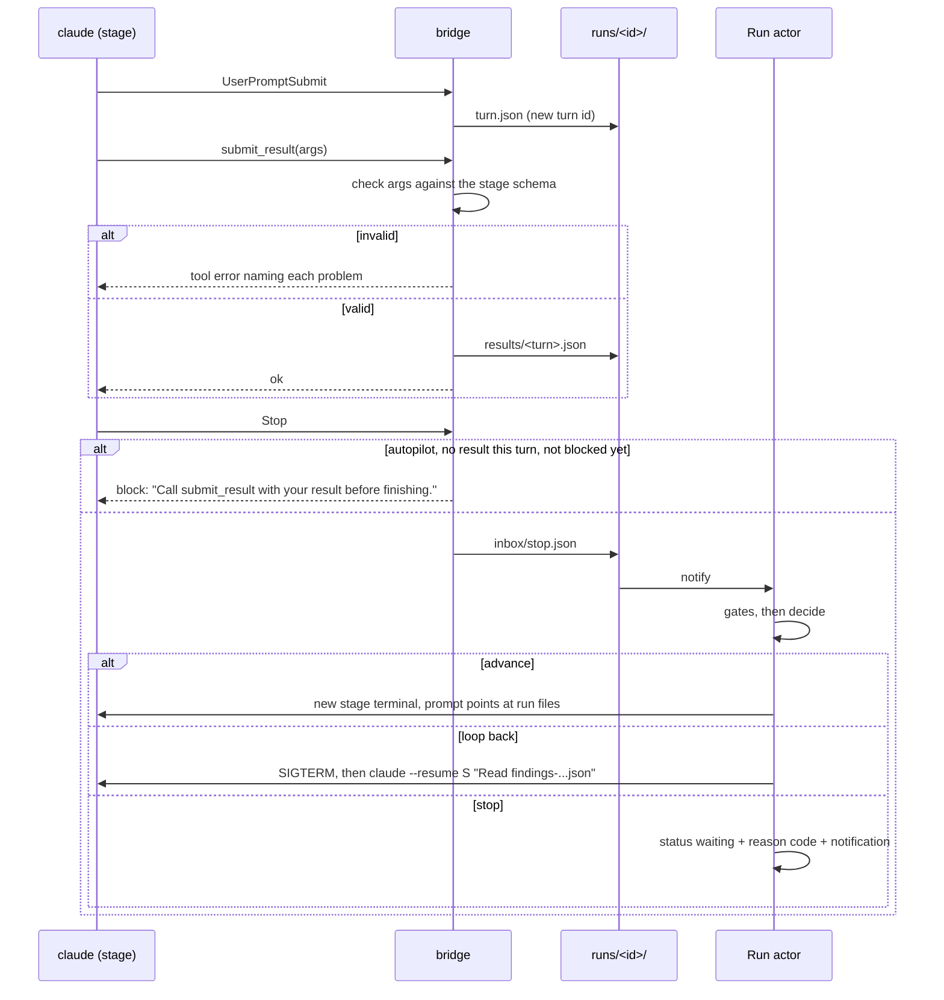

# Pipeline v2 and Autopilot Hardening Plan

2026-10-18 · JT

> Repository copy of the approved working plan (decision D35), taken on 2026-10-19 for V1. The decisions it records are in [ADR-015](../adr/015-pipeline-v2-stop-hook-bridge-run-actor.md). The Bug ledger statuses were filled in from ClickUp on 2026-10-19; ClickUp stays the live bug list. Where the shipped V2a to V6 code refined a rule (the run folder layout, D17's paste fallback, the D24 gate, "Done when"), this copy says so and ADR-015 has the details; other decision rows are as approved on 2026-10-18, and ADR-015's decision log has the V0 amendments.

Three tracks, in order: make the app and its UI something you can trust every day, harden today's autopilot, then rebuild how the orchestrator talks to each stage's `claude` terminal (Stop hook for turn ends, a `submit_result` tool for results, Rust as the only driver). Every open question is decided below so work can start without waiting on calls.

## Summary

**The problem.** Autopilot guesses. It reads turn ends from the session log, verdicts from prose, "needs you" from screen bytes pinned to Claude Code 2.1.287, and it carries decisions out in React by pasting keystrokes. Almost every recent fix (claims, stale and interrupted turns, re-asks) patches a symptom of that.

**The plan, in order.**

1. **Track S — app and UI stability (first, and the gate for everything else).** Collect every bug you hit plus a sweep for known defect classes, fix them by severity with a regression test each, and close the structural gaps that keep producing UI bugs. No new features until Track S meets its exit bar.
2. **Track H — autopilot hardening (5 PRs).** A fake `claude` test harness first (it starts during Track S), then an explicit run status, restart recovery, a stall watchdog, loud failures instead of silent passes, and honest usage handling. Most of it becomes v2's foundation.
3. **Phase V0 — verify Claude Code live (no code).** Can run at any time. A go/no-go on hooks, MCP and resume.
4. **Track V — pipeline v2 (7 PRs), built by layer, not by stage**, starting only after Track S exits:
    1. Signals: Stop and UserPromptSubmit hooks for turn ends, `submit_result` for results, on today's visible terminals.
    2. One owner: a Rust run actor drives everything; React only renders and sends user actions.
    3. Resume on loop-back and hand-offs through files.
    4. Hidden stages with Watch and Take over.
    5. Remove the old executor and claims.

**Headline decisions** (all in the Decision log):

- **File-based bridge, no HTTP server.** Hooks are `command` hooks and the MCP server is stdio, both the `dcterminal` binary run as a subcommand. They write into `runs/<id>/`, and Rust watches the folder with `notify`. No port, no token, no async runtime.
- **The Planner's result is its ExitPlanMode call**, captured by a PreToolUse hook that checks the tasks JSON and then ends the turn. Reviewers and the Implementer use `submit_result`.
- **Block at most once per turn.** A second stop with no result ends the turn and stops the run with reason `no_result`.
- **Gates run after the Stop hook, not inside it.** A failure resumes the same session with the gate output.
- **Every pipeline stage launches with hooks and MCP**, autopilot or not. Autopilot only decides whether Rust acts.
- **Old runs keep the v1 path** until V6, marked by `engine: 2` on new runs.

## Track S — app and UI stability

**Why first.** You need to trust the app before anything is built on it. Since 2026-10-10, 70 of 250 commits were fixes, yet nothing is tracked: no open GitHub issues and no bug list. So the bugs you hit live only in your head. Track S makes them visible, fixes them for good, and closes the gaps that keep producing new ones.

**Rule while Track S runs:** no new features. Phase V0 (no code) and H1, the test harness (tests only), may run alongside.

### S0 — intake (about 1 day)

- **You:** add bugs to the Bug ledger (or ClickUp) whenever you hit them. Ongoing, not a gate: S0 starts without it.
- **Me:** run the full Playwright suite on WebKit and Chromium. It has never been run on the newest specs.
- **Me:** write a 20-minute smoke checklist for the built app (install, new tab picker, Claude terminal, chat view, split and grid, files with Mermaid, localhost preview, GitHub tab, second window, quit and reopen). **You** run it once, at the exit bar, on `~/.claude-account1`, since driving the live app myself was ruled out on 2026-10-10.
- **Me:** sweep the code for the defect classes below and log each confirmed hit.
- Every entry gets a severity: **CRITICAL** = crash, data loss or can't start. **HIGH** = blocks a daily flow. **MEDIUM** = wrong, but there's a workaround. **LOW** = cosmetic.

### Defect classes to sweep (found during onboarding)

| Class | What you'd see | Evidence |
|---|---|---|
| UI freezes | The window stops responding for seconds | Sync commands run on the main thread. `claude_account_logins` holds the settings lock across up to 20 s per account (`commands/providers.rs:79`). `pty_resize` holds the global terminal lock for up to 2 s (`pty/mod.rs:987`). `detect_cli` has no timeout. Every state change fsyncs on the main thread |
| Whole window goes blank | One render error wipes the workspace | One ErrorBoundary, at the root (`main.tsx`) |
| Things silently don't happen | A click does nothing; a resize or keystroke is lost | About 40 `.catch(() => {})` in the UI, including `ptyWrite` and `ptyResize` (`TerminalView.tsx:260, 303`); events sent with `let _ = app.emit` |
| App won't open | Crash at launch after a bad shutdown or a downgrade | A corrupt `forms.json` or `roles.json`, or a `state.json` from another version, aborts startup (`forms_store.rs:26`, `roles_store.rs:20`, `state_store.rs:37`) |
| Edits lost across windows | Scratch pad text reverts | Each window re-saves every pad it holds, last writer wins (`useScratchPads.ts:56`) |
| Wrong tab status after a Claude Code upgrade | Needs you never shows | `permissionDialog.ts` is pinned to 2.1.287's screen bytes |
| Never checked for real | Unknown | Built app under the CSP, Mermaid, localhost preview; GitHub tab has no Playwright coverage |
| Known LOWs from 2026-10-16 | Small wrong states | In-app Restart keeps the old start time; turn coalescing reads the lane from text; preview overlay not dimmed in an unfocused split; PreviewFrame measures every render; a settings-load race |
| Slow launch | Window takes seconds to appear | Login-shell PATH probe blocks up to 3 s before the window opens (`shell_env.rs`) |

### S1 — fix by severity

- One PR per cluster of related bugs, worst first.
- **Every bug gets a test that fails before the fix**: Playwright for anything you can see, Vitest or `cargo test` for logic.
- The review loop stops at no MEDIUM+ finding and no regression; LOWs go to the ledger.

#### S1 plan: CRITICAL and HIGH (2026-10-18)

The 3 CRITICAL and 7 HIGH bugs ship as 8 draft PRs, worst first. All 10 were re-checked against master 543e260. Each fix starts with a test that fails. PR4 is stacked on PR1 and PR8 on PR7; the other six can be built in parallel. The full plan is in the implementer prompt, docs/plans/2026-10-18-s1-implementer-prompt.md (untracked, in the main checkout). The agent moves each ticket through in progress, in review and blocked, and adds its PR link here. JT sets complete on merge.

| PR | Fixes | Sev | The fix | Test that fails first | Depends on |
|---|---|---|---|---|---|
| [PR1 (#64)](https://github.com/jtfrancisco0121/DCTerminal/pull/64) | App won't open; an older build wipes settings, accounts, projects, GitHub filters | CRITICAL | One json_io helper. Damaged or other-version files are recovered or set aside as `.from-vN-<stamp>` (the sweep never deletes them). Startup never fails on content. A "Data recovered" notice appears | cargo: state v2, damaged forms/roles, newer settings survive two saves and the sweep | none |
| [PR2 (#62)](https://github.com/jtfrancisco0121/DCTerminal/pull/62) | Scratch pad edits reverted by another window | CRITICAL | Save only pads this window changed. The store rejects older writes (client `updatedAt`). The local mirror merges per pad | cargo stale-write; vitest: flush saves only changed pads | none |
| [PR3 (#63)](https://github.com/jtfrancisco0121/DCTerminal/pull/63) | Reopened tab has an empty transcript | HIGH | Transcript rotation keeps open and closed tabs (`known_tab_ids`), also on Stop | cargo: a closed tab's transcript survives 31 saves | none |
| [PR4 (#67)](https://github.com/jtfrancisco0121/DCTerminal/pull/67) | Closing a window kills agents with no warning; tabs past 15 lost | HIGH | Confirm dialog when anything runs. A closed window keeps all its tabs. File › Reopen Closed Window brings them back on the same account | cargo: 20 tabs archived; Playwright: cancel keeps the window | PR1 |
| [PR5 (#61)](https://github.com/jtfrancisco0121/DCTerminal/pull/61) | Cmd+A or "a" approves permissions in every pane | HIGH | Card keys ignore Cmd/Ctrl/Alt, stand down while a dialog is open, answer only the focused pane. Escape no longer also cancels the turn | vitest + Playwright: two split panes | none |
| [PR6 (#65)](https://github.com/jtfrancisco0121/DCTerminal/pull/65) | Started inside Claude Code, Claude tabs write no session log | HIGH | Remove the inherited `CLAUDE*` session vars once at launch, keeping `CLAUDE_CONFIG_DIR` | cargo: var list and a child's env | none |
| [PR7 (#66)](https://github.com/jtfrancisco0121/DCTerminal/pull/66) | Providers settings freeze up to 20 s per account; resize stalls all terminals | HIGH | Login checks run off the main thread, without the lock, in parallel. Resize sends without waiting under the lock | cargo: lock free during check; stuck terminal | none |
| [PR8 (#68)](https://github.com/jtfrancisco0121/DCTerminal/pull/68) | Stopping an agent cuts its session log (SIGKILL only) | HIGH | SIGTERM, 1.5 s grace on a background thread, then SIGKILL. Quit waits at most 1.5 s in total | cargo: a TERM trap runs; a TERM-ignorer dies | PR7 |

Every PR passes `npm run check` and Playwright on both engines. The one known failure is the pre-existing eagle-eye spec. Out of scope and logged: Cmd+Q quits with no confirm (MEDIUM); `agent --version` with no timeout (MEDIUM).

### S2 — structural fixes that stop whole classes of bugs

1. **One ErrorBoundary per pane and per view**, with "Reload this pane" and the error written to the log drawer. A crash in one tab no longer blanks the app.
2. **No silent failures.** Every user-started action shows its error. Background calls report once through one helper into the log drawer instead of `.catch(() => {})`.
3. **Nothing slow on the main thread.** The commands above become async or use `spawn_blocking`, and no store lock is held across a process spawn. This becomes a review rule.
4. **The app always opens.** `forms.json` and `roles.json` use the same recovery as the other stores. A `state.json` from another version is moved aside, never deleted, and the app starts with a clear notice.
5. **Scratch pads save per pad with a version check**, so a stale window can't overwrite newer text.
6. **StartupForm is shrunk only where bugs are fixed.** Each fix pulls the code it touches into a tested hook or module. No big-bang rewrite, which would add more risk than it removes.
7. **Coverage gaps closed:** GitHub handlers in the Playwright mock; the Python fake skip fails loudly instead of passing. A Playwright project serves the built app under the production CSP, covering the CSP, Mermaid and localhost preview without a live app.

### Exit bar — what "pitch perfect" means

- No open CRITICAL, HIGH or MEDIUM in the ledger.
- `npm run check` is green, and Playwright is green on WebKit and Chromium with no new skips.
- The built-app smoke checklist passes on a fresh install.
- **5 working days of your normal use with no new MEDIUM+ bug.** This is the one that matters: it's how you'll know the app is trustworthy.
- Every fixed bug has a test that failed before its fix, so it can't come back quietly.

## Bug ledger

Add a row whenever something goes wrong, even half-described. Severity can be a guess; I'll confirm it. A bug moves to Fixed only with a test that failed before the fix.

| # | Bug: what you did, what happened | Area | Severity | Status | Found by | Test / PR |
|---|---|---|---|---|---|---|
| 1 | A damaged `forms.json` or `roles.json`, or a `state.json` from another version, stops the app from opening | Startup | CRITICAL | Fixed (ClickUp 14yq6g2ywqu: complete) | Code sweep | [PR1 (#64)](https://github.com/jtfrancisco0121/DCTerminal/pull/64) |
| 2 | Settings › Providers can freeze the whole window: it checks every Claude account's login (up to 20 s each) on the main thread while holding the settings lock | Settings | HIGH | Fixed (ClickUp 14yq6g2ywqv: complete) | Code sweep | [PR7 (#66)](https://github.com/jtfrancisco0121/DCTerminal/pull/66) |
| 3 | Resizing a terminal can stall every terminal for up to 2 s: the resize waits for an answer while holding the global terminal lock | Terminal | HIGH (raised from MEDIUM in S0) | Fixed (ClickUp 14yq6g2ywqw: complete) | Code sweep | [PR7 (#66)](https://github.com/jtfrancisco0121/DCTerminal/pull/66) |

Rows 4 to 6 were empty placeholders for JT's own bugs; they were dropped here because every bug since S0 is a ClickUp task (below).

**Update 2026-10-18 (S0 done):** the full bug list now lives in [ClickUp › DCTerminal › Tasks](https://app.clickup.com/1300420000012159/v/li/1300420000080047) under Track S, as 25 bug tasks. The S0 code sweep, the Playwright run and V0 found 22 new ones; rows 1–3 above are tasks there too, and row 3 is now HIGH. The worst:

- **Can't open:** a damaged `roles.json` or `forms.json`, or a `state.json` from a newer build, stops the app from starting.
- **Data loss:** opening an older build wipes settings and accounts; scratch-pad edits are lost across windows; reopened tabs come back without their history.
- **Safety:** Cmd+A (or plain "a") approves pending tool permissions in every pane.
- **Freezes:** Providers settings, terminal resizing, folder pick with Claude history, and storage size all block the window.
- **Broken status:** started from inside a Claude Code session, DCTerminal's Claude tabs write no session log.

Playwright: 12 outdated specs fixed in draft PR [#60](https://github.com/jtfrancisco0121/DCTerminal/pull/60). The one failing spec left is a real app bug: the chain overview scrolls sideways. V0 results: draft PR [#59](https://github.com/jtfrancisco0121/DCTerminal/pull/59).

## Ground truth: Claude Code 2.1.287

Installed: `claude` 2.1.287 at `/opt/homebrew/bin/claude`. Phase 0 runs only in `~/.claude-account1`, in a scratch git repo, using launch flags only. Nothing is written to any config folder.

**Confirmed by the docs**

| Behavior | Source |
|---|---|
| `--settings` takes inline JSON; its hooks run in interactive mode and merge with user settings | [CLI reference](https://code.claude.com/docs/en/cli-reference.md), [hooks](https://code.claude.com/docs/en/hooks.md) |
| `http` and `command` hook types exist; `command` has an `args` array and a 600 s default timeout | [hooks](https://code.claude.com/docs/en/hooks.md) |
| `--mcp-config` takes inline JSON; stdio and http servers both work | [MCP](https://code.claude.com/docs/en/mcp.md) |
| `--resume <id> "<prompt>"` starts that turn at once and keeps the same session id and `.jsonl` | [sessions](https://code.claude.com/docs/en/sessions.md) |
| SIGTERM exits with code 143 and runs `SessionEnd` hooks | [headless](https://code.claude.com/docs/en/headless.md) |
| `disableAllHooks` in managed settings turns every hook off | [managed settings](https://code.claude.com/docs/en/managed-settings.md) |
| `auto` permission mode uses a classifier instead of prompts | [permission modes](https://code.claude.com/docs/en/permission-modes.md) |

**Not documented, so Phase 0 tests them** (each has a pass rule and a fallback):

| # | Question | Pass when | If it fails |
|---|---|---|---|
| T1 | Do `--settings` Stop and UserPromptSubmit hooks fire in the TUI? | Both fire once per turn with `session_id` | Stop: v2 is no-go. Report and wait |
| T2 | What is in the Stop payload? (`stop_hook_active`, `last_assistant_message`, `prompt_id`) | We record the real fields | Read the last reply from the log, as today |
| T3 | Does `{"decision":"block","reason":…}` (or exit 2) keep the turn going, with the reason shown to Claude? | Claude continues and reacts to the reason | Use a re-ask through resume instead |
| T4 | Does the Stop hook fire when you press Esc? | Record either way | If it fires, the hook skips enforcement when the log shows an interrupt |
| T5 | Does a stdio MCP server from inline `--mcp-config` load, and does `--allowedTools mcp__dcterminal__submit_result` stop the prompt in `auto`? | The tool runs with no prompt | Add a PreToolUse hook that answers `allow` for that one tool |
| T6 | Can MCP tools run in `plan` mode? | Record either way | Not needed: the Planner uses ExitPlanMode (D7) |
| T7 | Does a PreToolUse hook on ExitPlanMode see the plan text, and does `deny` with a reason end the turn cleanly? | Plan text in `tool_input`; the turn ends with no approval dialog | Planner falls back to `submit_result` after the plan (needs T6) |
| T8 | Does a Notification hook fire for permission prompts and idle, and with what fields? | A distinct type for each | Keep screen scraping for Needs you |
| T9 | Does the statusLine command's input include 5-hour and 7-day usage? | Usage fields present | Usage stays unknown for terminals (H5) |
| T10 | Does the `dcterminal` binary run as a hook or MCP subcommand with no Dock icon or window on macOS? | Silent, under 100 ms | A separate small `dct-bridge` binary bundled as a Tauri sidecar |
| T11 | Does SIGTERM leave the `.jsonl` complete, and does `--resume` then work? | The last turn is intact | SIGTERM, wait for exit, then SIGKILL after 10 s |

The results go in `docs/claude-hooks-observed.md`, together with the exact payloads captured.

## Target architecture (v2)

Rust launches each stage's `claude` itself, with three things added on the command line: hooks (`--settings`), a one-tool MCP server (`--mcp-config`), and permission for that one tool (`--allowedTools`). Both the hooks and the MCP server are the `dcterminal` binary run as a subcommand, called the **bridge**. The bridge only writes files into the run folder. A **run actor** in Rust (one thread per active run) is the only thing that acts on a run.



**Run folder** (`<app data>/runs/<runId>/`):

```
run.json                   the run id, checked by the bridge (D37)
plan.md, tasks.json        Planner output (tasks drive fan-out)
prs.json, prs-<lane>.json  Implementer output (prs-<lane>.json in a lane)
findings-<stage>-r<N>.json reviewer output per round, written by the actor (V4)
bridge.log                 what went wrong, unknown payload fields (D24)
stages/<stage>[@lane]/
  stage.json               stage, role, lane, owning tab, result schema
  mode                     autopilot | manual | takeover
  turn.json                current turn: prompt_id, start, blocked, end
  results/<turn>.json      what submit_result received, already validated
  payloads/<Event>.json    newest raw hook payload per event
  needs.json               the last Needs you posted (Notification dedupe)
inbox/                     events the bridge drops; the actor reads and deletes them
```

**One turn on autopilot:**



Manual tabs outside a pipeline launch exactly as today, with no hooks and no MCP.

## Track H — autopilot hardening

Five draft PRs. H1 starts during Track S; the rest follow once Track S exits. Each one targets a failure that survives v2, so none of this work is thrown away.

| PR | What | Done when |
|---|---|---|
| **H1 — fake `claude`** | A Rust `[[bin]] fake_claude` (no Python). It reads a scenario file (turns, replies, tool uses, delays, interrupts, exit) and writes a `.jsonl` exactly where and how real Claude does. It accepts `--session-id`, `--resume`, `--permission-mode`, and draws a screen. Tests spawn it in a real `PtySession`. The ACP flow tests fail loudly when `python3` is missing instead of passing without running. | Scenario tests cover turn done, interrupt, ExitPlanMode, sub-agents, a crash mid-turn and resume. In V2 the same binary learns to run hooks and call MCP |
| **H2 — run status** | `status: running \| waiting \| complete \| stopped` and a `stopReason` code on `PipelineRun`, migrated from today's fields. `decide` acts only while `running`; `complete` is final. Also: record the round before pasting a loop-back; reset `gate_retries` when a gate passes; set the provider before launch; fix the log-ref ordering behind false "newer prompt" skips | Late turns after completion are ignored; a failed loop-back record stops the run with `carry_out_failed` instead of silently skipping |
| **H3 — restart recovery and stall watchdog** | At startup each `running` autopilot run is reconciled against its stages' logs. A finished turn nobody decided puts the run in `waiting` with reason `app_restarted` and a **Continue** button; it never acts by itself. While a stage is Working, no PTY output and no log growth for `autopilot.stallMinutes` (default 30) stops the run with `stalled` | Fake-claude tests for quit mid-turn, quit after turn, and a hung tool |
| **H4 — loud failures and stage kinds** | `kind: planner \| reviewer \| implementer \| generic` on each stage, defaulting from the built-in role id. Every check now keyed on `role_planner` and friends reads the kind instead, so a copied role behaves like its original. User pipelines are validated on load: an invalid one shows as disabled with the reason, never dropped. Role ids must exist. An unknown run kind is an error, not a silent Eagle-Eye 1. An `auto` gate that finds nothing to run stops with `no_check_found` unless the gate is marked `optional` | A duplicated PR Reviewer in a custom pipeline re-asks and loops exactly like the built-in one |
| **H5 — usage and stop reasons** | Usage that is stale or missing reads as **unknown**, never 0%. Autopilot keeps going when usage is unknown, but a rate-limit error in a stage's log stops the run with `usage_limit`. Every stop carries one reason code, shown on the overview, in the notification and in the ledger | Each reason code has a test and a plain-English line |

**Stop reason codes:** `checkpoint`, `gate_failed`, `no_check_found`, `no_result` (v1: `missing_sections`), `no_verdict`, `blocking_findings`, `round_cap`, `usage_limit`, `stalled`, `app_restarted`, `carry_out_failed`, `taken_over`, `paused_by_you`.

## Track V — pipeline v2

Seven draft PRs. V0 and V1 are docs only. Code starts only after Track S exits and H1 to H3 are merged. New runs get `engine: 2`; older runs keep the v1 path until V6.

| Phase | What | Done when |
|---|---|---|
| **V0 — verify** | Run T1 to T11 from Ground truth and write `docs/claude-hooks-observed.md` with the captured payloads | Every test has a recorded result. **If T1 fails, stop and report: v2 is no-go as designed** |
| **V1 — ADR-015** | Supersedes ADR-014 §4 (turn end from the log), §5 (frontend carries decisions out) and §7 (results as fenced JSON). Keeps every ADR-014 guardrail. Records the decision log below | You approve it |
| **V2a — signals for reviewers** | The `dcterminal bridge` subcommand: hook mode and MCP mode. The run folder. UserPromptSubmit and Stop hooks. `submit_result` for Plan Reviewer and PR Reviewer. Block once per turn. A `{{result_instructions}}` token in the role templates, filled only on engine-2 stages. Today's executor reads turn end and result from Rust instead of parsing. `fake_claude` learns to run hooks and call MCP | Rust unit tests for the bridge (hook decisions, schema validation, block-once) and a fake-claude run where a reviewer forgets the tool, is blocked once, then submits |
| **V2b — signals for Planner and Implementer** | Planner: a PreToolUse hook on ExitPlanMode saves `plan.md` and `tasks.json` and answers `deny` with "Plan received", which ends the turn without the approval dialog. Implementer: `submit_result` with `prs[]`. Fan-out reads `tasks.json` directly. A Notification hook becomes the main Needs you signal; screen scraping stays as the fallback | Fake-claude Eagle-Eye 1 with turn ends, verdicts and tasks all from the bridge |
| **V3 — one owner** | The run actor: one Rust thread per active run that spawns stage terminals, runs gates, decides and advances. It builds launch prompts in Rust from the role template and the run files. `useAutopilot` stops carrying anything out for engine-2 runs. Manual buttons on engine-2 runs (Send, Send back, Approve, Continue) become messages to the actor. The actor processing one message at a time, plus turn-id dedupe, replaces claims | A `cargo test` runs a whole Eagle-Eye 1 on `fake_claude` with no UI, including a loop-back and a failed gate |
| **V4 — resume and file hand-offs** | Loop-back and gate failure: SIGTERM, wait for exit (SIGKILL after 10 s), then relaunch `claude --resume S` with the same flags and a short prompt that points at `findings-<stage>-r<N>.json` or the gate output. The stage's view stays and is pointed at the new process. Next-stage prompts point at `plan.md`, `tasks.json` and `prs.json` instead of mapped form fields | Unit tests for the resume flow; a fake-claude run shows the same session id across a loop-back |
| **V5 — hidden stages** | Stages start hidden at 120×40, each with a 2 MB output ring buffer. **Watch** replays the buffer, then goes live, and resizes once to force a clean redraw. Watch is read-only except while the stage needs you or is taken over. **Take over** stops enforcement and decisions for that stage; **Hand back** resumes them, deciding at once if the current turn already has a result | Closing a Watch view never stops a stage; typing is possible only in Needs you or Take over |
| **V6 — cleanup** | Delete the v1 autopilot carry-out, claims and executor autopilot code. Engine-1 runs become manual-only, with a note. Regex parsers stay only to display old runs. Update README, `docs/pipelines/README.md` and `PIPELINE-REPLY-GUIDE.md` | `npm run check` is green with the dead code gone; the end-to-end acceptance run passes |

### Result schemas (`submit_result` input, `schema: 1`)

- **Reviewers** (Plan Reviewer and PR Reviewer): `verdict`, one of `APPROVED`, `APPROVED_WITH_CHANGES`, `CHANGES_REQUIRED`. `findings[]`, at most 100, each with `severity` (`CRITICAL`, `HIGH`, `MEDIUM`, `LOW`, `INFO`), `summary` (at most 300 characters), and optionally `pr` (`PR1`), `file` (`path:line`) and `regression` (true or false).
- **Implementer:** `prs[]`, 1 to 8, each with `url`, `branch`, `title` and optionally `lane`. `summary`. Optionally `checks[]` of `{command, passed}`.
- **Planner** (a fenced JSON block inside the ExitPlanMode plan): `tasks[]`, 1 to 8, each with `id` (`pr1`), `title`, `dependsOn[]`, `manual` and `summary`. A one-PR plan has one task.

The bridge checks every field and returns a tool error that names each problem, so Claude fixes it in the same turn. Old verdict words ("REQUEST CHANGES", "REQUIRES REVISION") are rejected by `submit_result` with a tool error that names `CHANGES_REQUIRED`.

## Decision log

Every question I expect you to face, decided. Each has the reason and the evidence that would change it. Rows marked **(needs JT)** change one of your standing preferences, so they wait for your OK; everything else proceeds as written.

### Order and quality

| # | Question | Decision and why | Reverse if |
|---|---|---|---|
| D1 | What comes first? | Track S, then H, then V. V0 can run at any time. Trust in the app comes before new machinery | Never; the order is the point |
| D2 | New features during Track S? | None. Only bug fixes, tests and the S2 structural fixes | A bug can only be fixed by a feature (then it counts as a fix) |
| D3 | What does "pitch perfect" mean? | The Track S exit bar, ending with 5 working days of your normal use with no new MEDIUM+ bug | — |
| D4 | Rewrite StartupForm? | No. Extract only the code each fix touches, into tested modules. A rewrite of 6,100 lines would bring its own bugs | Bugs keep clustering in StartupForm's wiring after S1 |
| D5 | Run Playwright? **(decided 2026-10-18)** | Yes: the full suite on every Track S PR. It uses no Claude usage, only a few minutes of machine time. This overrides "no Playwright unless asked" for Track S only | You'd rather run it yourself at the exit bar |
| D6 | Who checks the built app by hand? | You run the 20-minute smoke checklist I write, once, at the exit bar. A Playwright project on the built app under the production CSP covers the rest. I don't drive the live app (your 2026-10-10 call) | — |

### v2 design

| # | Question | Decision and why | Reverse if |
|---|---|---|---|
| D7 | Build v2 by stage or by layer? | By layer: signals, then one owner, then resume, then hidden. Each layer is useful on its own if the next stalls | — |
| D8 | HTTP endpoint or files? | Files. `command` hooks and a stdio MCP server, both `dcterminal bridge`, writing into the run folder; Rust watches it with `notify`. No port, token, firewall prompt or async runtime | T10 fails: use a small sidecar binary. Command hooks prove unreliable: use `http` hooks |
| D9 | How is a turn identified? | UserPromptSubmit writes the turn id: Claude's `prompt_id` if T2 shows it in both payloads, else a counter | — |
| D10 | What if Claude never calls `submit_result`? | Block once per turn. A second stop with no result ends the turn and stops the run with `no_result`. Never an endless loop | — |
| D11 | How does the Planner report? | Through its ExitPlanMode call: a PreToolUse hook saves the plan and tasks, then answers `deny` with "Plan received", which ends the turn with no approval dialog | T7 fails: the Planner calls `submit_result` after its plan |
| D12 | How do Reviewers and the Implementer report? | `submit_result`, allowed up front with `--allowedTools mcp__dcterminal__submit_result` | T5 shows it still prompts: a PreToolUse hook answers `allow` for that one tool |
| D13 | Hooks and MCP on every pipeline stage, or only autopilot? | Every pipeline stage. Autopilot only decides whether Rust acts, so turning it on mid-run just works and manual runs get structured results too. Enforcement (the block) applies only on autopilot and not while taken over | — |
| D14 | Use `--strict-mcp-config`? | No. Your own MCP servers stay available to stages | Your servers interfere with stages |
| D15 | Your own Stop hooks? | They still run (settings merge); documented in ADR-015 | One of them blocks stages: we document how to scope it |
| D16 | Gates inside the Stop hook? | No. The hook returns at once; the actor runs gates after, and a failure resumes the session with the output. A hook that waits minutes would freeze the terminal | — |
| D17 | How does a loop-back restart? | SIGTERM, wait for exit, SIGKILL after 10 s, then `claude --resume S` with the same flags and a short prompt pointing at the findings file. No keystrokes (as shipped: a running stage with no saved Claude session still gets one paste after Ctrl+U, D40; see ADR-015 §4) | T11 shows SIGTERM damages the log: send `/exit` as the one allowed keystroke and wait |
| D18 | Who carries decisions out? | One Rust run actor per active run. It handles one message at a time (bridge events, your buttons, gate results, exits, timers), which replaces claims. Your manual buttons on engine-2 runs go through it too | — |
| D19 | Old runs? | `engine: 2` on new runs. Engine-1 runs keep the v1 path until V6, then become manual-only | — |
| D20 | Hand-off content? | Next-stage prompts point at run files. A manual Send on an engine-2 run opens the form prefilled from those files, still editable. Tabs outside a pipeline are unchanged | — |
| D21 | Keep `## HANDOFF:` prose in role templates? | Yes: you read it, and manual hand-offs use it. `{{result_instructions}}` adds the tool instructions only on engine-2 stages | — |
| D22 | Needs you signal? | The Notification hook first; screen scraping as the fallback | T8 shows no distinct permission type: scraping stays the main signal |
| D23 | Permission modes? | Unchanged: `plan` for the Planner, `auto` for every other role. Chat (ACP) autopilot stays out of scope | — |
| D24 | Which Claude Code versions? | v2 needs the version V0 verified, or newer. An older version launches engine-1 runs with a notice. A newer one is allowed; the bridge logs unknown payload fields and the overview says "Claude Code version not yet verified". As shipped: 2.1.287 or newer, an unreadable version counts as older, hooks turned off (`disableAllHooks` anywhere, managed `allowManagedHooksOnly`) also gives engine 1, the check runs at every bridged start and relaunch, and a switch mid-run makes the run manual for good (ADR-015 §6) | A newer version breaks the bridge: pin the maximum too |

### Hidden stages

| # | Question | Decision and why | Reverse if |
|---|---|---|---|
| D25 | How does Watch show a stage that ran hidden? | A 2 MB output ring buffer per stage, replayed on attach, then one resize to force a clean redraw | Replay looks broken in practice: keep a headless terminal (`vt100` crate) and send its screen |
| D26 | Size of a hidden terminal? | 120×40, resized to the view on attach | — |
| D27 | Can you type in a Watch view? | Only while the stage needs you or you have taken over. That rules out two drivers by accident | — |
| D28 | What does Hand back do? | Turns enforcement and decisions back on; if the current turn already has a result, the actor decides at once | — |

### Hardening

| # | Question | Decision and why | Reverse if |
|---|---|---|---|
| D29 | Act on a finished turn after a restart? | Never by itself. The run waits with `app_restarted` and a Continue button | — |
| D30 | Stall limit? | 30 minutes with no output and no log growth, set per pipeline (`autopilot.stallMinutes`) | Long quiet test suites trip it: raise the default |
| D31 | `auto` gate with nothing to run? | Stops with `no_check_found`, unless the gate is marked `optional` | — |
| D32 | Unknown usage? | Shown as unknown, never 0%. Autopilot continues. When usage is known and at or above `autopilot.pauseAtUsagePercent`, the run stops with `usage_limit` before the next hand-off; a rate-limit error in a stage's log also stops the run | — |
| D33 | How do copied roles behave? | A `kind` on each stage replaces every role-id check | — |

### Process

| # | Question | Decision and why | Reverse if |
|---|---|---|---|
| D34 | How is v2 tested without spending usage? | `fake_claude` in Rust for everything automated. Live runs on `~/.claude-account1` only for V0 and the final acceptance run | — |
| D35 | Where do the docs live? | This doc is the working plan. ADR-015, `docs/claude-hooks-observed.md`, and a copy of this plan as `docs/plans/2026-10-18-pipeline-v2-plan.md` go in the repo with V0 and V1 | — |
| D36 | PRs and merging? | One draft PR per row, branched from `master`. Review loop until no MEDIUM+ and no regression. Merged only when you approve | — |
| D37 | Bridge safety? | The bridge writes only inside the run folder named on its command line, checks the run id and stage name, and makes no network calls. The folder lives in app data | — |
| D38 | Windows? | Hooks use the `args` array, so there is no shell quoting. The bridge path comes from the running executable | — |

### Amendments from V0 (2026-10-18, live on Claude Code 2.1.287)

V0 passed T1: hooks from inline `--settings` fire in the interactive TUI, so v2 is a go. Full results are in `docs/claude-hooks-observed.md` (branch `v0/claude-hooks-observed`). These rows change or confirm earlier decisions:

| # | Change | Evidence |
|---|---|---|
| D9 | **Confirmed.** The turn id is Claude's `prompt_id`, the same in UserPromptSubmit and Stop. Stop also carries `last_assistant_message`, so nothing is parsed from the log at turn end | T2 |
| D9a (new) | **Stop does not fire on Esc or on a rejected permission.** A UserPromptSubmit with no Stop is an abandoned turn: autopilot never acts on it. A later UserPromptSubmit, an `idle_prompt` Notification or the stall watchdog closes it out | T4 |
| D10 | **Confirmed, with a wording rule.** Block only when `stop_hook_active` is false, and the reason names the exact tool and arguments. A vague reason made Haiku ask the user instead | T3 |
| D11 | **Confirmed.** PreToolUse(ExitPlanMode) carries the full plan; `deny` ends the turn with no dialog, and Stop still fires | T7 |
| D12 | **Changed.** Always pass `--allowedTools mcp__dcterminal__submit_result`, **and** add a PreToolUse hook answering `allow` for that tool, because plan mode still prompts despite the allowlist | T5, T6 |
| D12a (new) | **Auto mode is unavailable on Haiku**: the session silently runs in `default`. A role set to Haiku asks before risky actions more often; the overview says so | T5 |
| D17 | **Confirmed.** SIGTERM exits in 0.6 s with the log complete and SessionEnd fired; `--resume <id> "prompt"` starts at once with the same id and log | T11 |
| D22 | **Changed.** The **PermissionRequest** hook is the Needs-you signal (immediate). The `permission_prompt` Notification lags about 6 s, so it is only a backup | T8 |
| D32 | **Changed, and pulled forward into H5.** The statusLine command's input carries `rate_limits.five_hour` and `seven_day` (`used_percentage`, `resets_at`), so terminal tabs can report usage. Treat it as optional: it's missing on the first render | T9 |
| D39 (new) | **Remove every inherited `CLAUDE*` env var except `CLAUDE_CONFIG_DIR`** when launching `claude`; otherwise Claude writes no session log. This is a live bug today (logged under Track S) | Gotchas |
| D40 (new) | **After an Esc, clear the input box** before the next prompt: Claude puts the interrupted prompt back | Gotchas |

## Where this departs from the original spec

| Spec said | This plan | Why |
|---|---|---|
| Start with v2 | Track S and Track H first | The app has to be trustworthy before new machinery sits on it |
| An `http` hook to a localhost endpoint; `command` only as a fallback | Files first; `http` only as the fallback (D8) | No server, port, token or async runtime to add; `notify` is already in use |
| Spike all features on the PR Reviewer, then go stage by stage | Build by layer; the PR Reviewer is still the first stage to get signals (V2a) | Each layer ships value on its own |
| The Planner calls `submit_result` with `tasks[]` | The Planner reports through ExitPlanMode (D11) | It runs in plan mode, where MCP tools may not be allowed, and ExitPlanMode is its natural end |
| Block whenever there is no result | Block once per turn, then stop with `no_result` (D10) | Otherwise one stubborn turn loops forever |
| Gates through the Stop hook | Gates after the hook, in the actor (D16) | A hook that waits minutes freezes the terminal |
| Resume "in the same PTY" | The same view, with a new process behind it (D17) | A PTY ends with its process; the view is what you see |
| Delete claims | Replace them with the actor handling one message at a time (D18) | Your manual buttons can still race autopilot; something must order them |
| Delete the mapping code | Keep `map.ts` for manual hand-offs; delete only the autopilot executor and claims | Manual hand-offs keep using the form path |

## Risks and fallbacks

| Risk | Likelihood | What we do |
|---|---|---|
| A Claude Code update changes the hook payloads | Medium | The bridge keeps raw payloads in the run folder, unknown fields are logged, and engine-1 stays as the fallback until V6 (D24) |
| Inline hooks turned off by a managed `disableAllHooks` policy | Low on your machine | Checked at every bridged start and relaunch (also a managed `allowManagedHooksOnly`); such runs fall back to engine 1, manual only since V6, with a notice |
| The bug list from Track S turns out much longer than expected | Medium | The exit bar holds; V waits. Severity decides the order, so the worst problems go first |
| Replaying the buffer into Watch garbles the screen | Medium | Use the headless terminal fallback (D25) |
| Kill and resume costs time on every loop-back | Certain, small | A few seconds per round; resume keeps the conversation, and the prompt cache usually survives |
| Two drivers on one stage | Low after V3 | The actor handles one message at a time; Watch is read-only outside Needs you and Take over |
| The actor thread panics | Low | The run goes to `stopped` with `carry_out_failed`; the stages keep running and you can take them over |
| Usage limit hit mid-stage | Medium | H5 stops the run on the first rate-limit error; T9 may give real numbers |

## Done when

**Track S** is done at its exit bar. **The whole plan** is done when one Eagle-Eye 1 run on autopilot, live on `~/.claude-account1` against a scratch repo, does all of this:

- Goes plan → plan review → checkpoint → implement → checks → PR review, every stage hidden but watchable.
- Every turn end comes from the Stop hook, and every verdict and task list from the bridge, with no regex parsing.
- A PR Reviewer "changes required" resumes the **same** Implementer session id.
- A failing check resumes the Implementer with the check's output.
- Autopilot pastes no keystrokes (the D40 paste after Ctrl+U is only for a stage with no saved Claude session, which this run should not have).
- Quitting the app mid-run and reopening it shows `app_restarted` with Continue, and Continue finishes the run.
- Take over, a typed question, and Hand back work without a block or a double hand-off.
- Nothing was written to `~/.claude*` by DCTerminal, and no pull request was merged.

## What needs you

Decided on 2026-10-18, when you delegated these ("Finalize START HERE, you can decide"):

- **Bug list:** not a gate. S0 starts with my code sweep and a full Playwright run; you log bugs whenever you hit them.
- **D5:** yes, the full Playwright suite on every Track S PR.
- **V0:** approved on `~/.claude-account1`, in a scratch repo, launch flags only, alongside S0.
- **Smoke test:** built-app checks are automated (Playwright on the built app under the production CSP); you run the manual checklist once, at the S-exit bar.

Still yours:

- **S-exit:** run the smoke checklist (about 20 minutes) and confirm 5 working days with no new MEDIUM+ bug.
- **V1:** approve ADR-015.
- **Each PR:** review and merge when you're happy. Nothing merges without you.

Tickets: [ClickUp › DCTerminal › Tasks](https://app.clickup.com/1300420000012159/v/li/1300420000080047)

Any decision above can be changed by commenting on its row.
