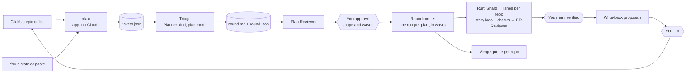

# Eagle-Eye v3 Plan: ClickUp intake, rounds, multi-repo lanes

2026-10-22 · JT · **Approved 2026-10-22; build started**

Eagle-Eye stays the one pipeline. v3 lets it start from ClickUp tickets (or from what you dictate), run a whole QA round as plans in merge waves, build a plan that spans several repos, and work through several stories inside one PR with a check after each. It reports results back to ClickUp after you approve them.

**BMAD is not part of the build.** It is never installed and never runs: no `npx bmad-method`, no `_bmad/` folder, no `uv`, no BMAD menus. Three of its ideas are built into Eagle-Eye under Eagle-Eye names: the plan check before code (the Plan Reviewer and your Approve), stories with "done when" and planned tests (the story format), and PRD and architecture documents for big new features (Track F, last and optional).

The worked example throughout is [QA 1.2.8 Medium/Low Fix Plans](../sample%20plans/qa-1.2.8-medium-low-fix-plans.html): 29 tickets, 8 plans, 4 merge waves, 4 repos.

## Summary

**The problem.** Today a run is one task, in one repo, with at most 8 PRs and one turn per PR. Your real work is a round: tickets from ClickUp, triaged into plans, each plan touching backend, engine, desktop and web, merged in waves, and done only when verified. That round was planned by hand in a doc, and nothing in the pipeline can run it.

**The plan, in order.**

1. **Phase 0: spike (no app code).** Check the ClickUp API calls on your workspace, the `go test` gates, and lanes in two repos at once.
2. **Track C: ClickUp (3 PRs).** The app gets a ClickUp client with your token, kept in the OS keychain. Intake takes a snapshot of the tickets into the run folder. Write-back posts comments and status changes, each one approved by you.
3. **Track L: lanes (3 PRs).** Lanes across repos, a check command per repo plus a "verified" checkpoint, and a story loop inside a lane.
4. **Track R: rounds (3 PRs).** A Triage stage that writes the round (plans, waves, deferred and parked plans), a round runner that starts one run per plan in wave order, and a merge-queue view per repo.
5. **Track F: feature documents (3 PRs, optional, last).** An `artifact` stage kind, Analyst, PM and Architect roles written as our own templates, and sizes S, M and L.

Tracks C, L and R are what the QA 1.2.8 round needs. Track F is for new-feature work and can wait.

**Headline decisions** (all in the Decision log):

- **The app talks to ClickUp, not Claude.** Your token is stored in the OS keychain and used only by Rust. No stage's `claude` sees it, so it never reaches a prompt, a transcript or a session log. ClickUp access does not depend on which Claude account a window uses.
- **Intake is a snapshot.** `tickets.json` is fetched once per run. A ticket edited later shows as "changed since intake", and you choose whether to pull it in again.
- **Write-back needs your approval per ticket.** The run report proposes a comment and a status change for each ticket. You tick the ones to send, and the app posts only those.
- **A round is several runs, not one big run.** One run per plan keeps each plan's stops, rounds and checkpoints separate. The engine stays as it is; waves sit on top.
- **The engine changes are additive.** Eagle-Eye 1 and 2 runs behave exactly as today, and actor tests pin that.

## Decisions so far (JT, 2026-10-22)

| Question | Answer |
|---|---|
| Final pipeline | Eagle-Eye only |
| Source of tickets | ClickUp, or dictated |
| ClickUp access | Your ClickUp token (no MCP server) |
| Claude account for a run | Either account; it depends on the window |
| Write-back | Comments and status changes |
| BMAD | Not installed, never run. Three ideas built into Eagle-Eye (E12) |
| PR shape | One PR per repo per plan, stories inside it (E7) |

## Target flow



## Build order

| Batch | PRs | Base |
|---|---|---|
| 1 | E0 (this plan), **C1**, **L1** in parallel | master |
| 2 | **C2** (needs C1 and Phase 0 P1 to P3), **L2** | C1, L1 |
| 3 | **L3**, **C3** | L2, C2 |
| 4 | **R1**, **R2**, **R3** | C2 + L3 |
| 5 | **F1** to **F3**, only if wanted | master at that point |

Each PR is a draft, stacked on its dependency's branch while that is unmerged. JT reviews and merges.

## Phase 0: spike (no app code)

Live, on whichever account the window uses, in scratch clones. The answers go into this plan before any PR starts.

| # | Check | Pass when |
|---|---|---|
| P1 | ClickUp API with your token: fetch the epic `z8uq9m3gga` with subtasks, one task's comments, and the list's statuses | All three return. The epic's tickets and their priorities match the QA 1.2.8 doc |
| P2 | Whether the ticket ids in the doc are ClickUp's own ids or custom task ids | We know which form the API needs (custom ids need `custom_task_ids=true` and the team id) |
| P3 | The rate limit your plan gets | We know the per-minute budget, so intake for 30 to 50 tickets stays inside it |
| P4 | `cd server && go test ./...` (backend) and `go test ./...` (engine) as gate commands, run through `$SHELL -l -c` from the app | Both pass or fail as they do in your own terminal |
| P5 | Two worktrees from two repos in one run, by hand | Both lanes build. Nothing in the run folder assumes one repo |
| P6 | Whether ClickUp's GitHub integration links a PR from the task id in the branch or title | We know the id format to put in branch names |

## Track C: ClickUp

| PR | What | Done when |
|---|---|---|
| **C1: ClickUp client and token** | A Rust module `clickup/` with blocking HTTPS calls on worker threads (the app has no async runtime). The token is stored in the OS keychain (macOS Keychain, Windows Credential Manager, Linux Secret Service). It is never written to any JSON file, log or the run folder, and never passed to a `claude` process. **Settings › Integrations › ClickUp**: paste the token, **Test** (shows your workspace name), **Remove**. The workspace id is kept in `settings.json`. Rate limits: honour the limit headers, back off on 429, and run at most 4 calls at once (the same rule the GitHub poller uses) | Unit tests on recorded responses. A test fails if the token ever shows up in a store file, log line or launch argument |
| **C2: Intake** | **Start round…** or **Start pipeline…** takes either a ClickUp source (an epic or task id with subtasks, or a list id, plus filters for priority, status and tags) or dictated text. ClickUp: Rust fetches the tasks and their comments and writes `tickets.json`. Dictated: the first stage gets the text, and Triage normalises it into the same shape. Tickets already closed are listed under "Excluded" with their status, as the QA doc does. A ticket edited after intake shows "changed since intake" on the overview, with **Pull again** | `tickets.json` for the QA 1.2.8 epic holds 29 open tickets and 3 excluded. Intake costs no Claude usage |
| **C3: Write-back** | At the end of each run, and when you mark a ticket verified, the overview shows one proposal per ticket: a comment (the PR links, what changed, how it was verified) and a status change. The status comes from a mapping you set once per list (for example "verified" → `QA PASSED`), read from that list's real statuses. You tick, edit or skip each proposal, then **Send**. The app posts only the ticked ones and records each result (sent, failed with reason) in the run's ledger. Nothing is ever sent without a tick. No other writes: no creating tickets, no deleting, no reassigning | A test proves an unticked proposal is never sent. A failed post shows the ClickUp error and can be retried |

## Track L: lanes

| PR | What | Done when |
|---|---|---|
| **L1: Lanes across repos** | A task in `tasks.json` can name a `repo`: a folder path, or a repo name from **Settings › Repos**, which maps names like `backend` to folders. Fan-out creates each lane's worktree in that lane's repo. `dependsOn` works across repos, so "backend before its clients" is a plain dependency. The run's own folder stays the "home" repo for stages that have no lane | A fake-claude actor test runs a two-repo plan: the backend lane, then the engine lane that depends on it |
| **L2: Checks per repo and verified checkpoints** | Gates can be set per repo (**Settings › Repos**: `backend` → `cd server && go test ./...`, `engine` → `go test ./...`) and override the stage's gate for lanes in that repo. A new gate kind, `verify`: the run waits with `checkpoint` and shows the steps you wrote (for example "run the qa128-ml Playwright project on the Windows staging build"). **Mark verified** passes the gate; **Failed** with a note sends the round back. This is how "done only when the verification command passes" is enforced for checks the app cannot run itself | Fake-claude tests for a per-repo gate failing and retrying, and for a `verify` gate passed and failed |
| **L3: Story loop** | A task can list `stories[]`. The lane's Implementer works through them in order in one session and one branch. After each story it calls `submit_result` with `story` set, the repo's gate runs, and the next story is sent only when the gate passes. A failed gate sends its output back for that story (the existing retry rule). A story can be a `checkpoint` (Plan 5's R5 instrumentation: stop, you rerun on Windows and read the log). The PR is reviewed once all stories pass | A fake-claude test runs Plan 5's shape: 4 stories, one failed check, one checkpoint story, then one PR review |

## Track R: rounds

| PR | What | Done when |
|---|---|---|
| **R1: Triage stage** | A Planner-kind stage (plan mode, ExitPlanMode) that reads `tickets.json` and the repos and writes a round. It confirms each ticket against the code, corrects claims that turn out wrong, groups tickets into plans by shared contract, orders the plans into waves by shared repos and files, and marks plans `deferred` (fix outside our repos) or `parked` (waiting on a product decision). `round.md` is for you to read and has the QA doc's sections. `round.json` is what the round runner uses. The Plan Reviewer reviews it, and a checkpoint asks you to approve the scope and the wave order | Given the QA 1.2.8 tickets in a fake-claude test, the bridge accepts a `round.json` shaped like the doc's 8 plans and 4 waves, and rejects one with a dependency cycle |
| **R2: Round runner** | A round holds one run per plan, each started from that plan's section of `round.json` (its first stage shards the plan into lanes and stories). Waves decide when runs start, plus a cap on runs at once (default 2) to protect usage. **Commit up to wave N** (your "commit only to wave 1 before 10-31") holds later waves as ready but not started. Parked and deferred plans never start; **Unpark** starts one. **Approve all checkpoints** collects every run's plan checkpoint in one view. A run that stops never stops the others | Fake-claude test: a round of 3 plans in 2 waves with a cap of 2; one run stops and the other keeps going |
| **R3: Merge queue** | One view per repo listing the round's PRs in merge order (from the waves and `dependsOn`), with the next one to merge highlighted. It warns when a PR's base has moved and it needs a rebase on staging, and never suggests two merges to one repo at once. Read-only: it never merges, rebases or pushes | For the QA 1.2.8 round it shows backend 1 → 2 → 4 → 3, engine 5 → 2 → 3, desktop 4 → 6 → 7 and web 4 → 7 |

## Track F: feature documents (optional, last)

| PR | What | Done when |
|---|---|---|
| **F1: `artifact` stage kind** | A bridged kind that runs in `auto` mode and reports through `submit_result`: `status` (`complete`, `partial`, `blocked`), `artifacts[]` (paths in the run folder) and `openQuestions[]`. `complete` advances; `partial` with questions waits with `checkpoint` and shows the questions, and your answers resume the stage's session. `engine_for` counts it as bridged | Actor tests for complete, partial with questions answered, and blocked |
| **F2: Analyst, PM and Architect roles** | Our own role templates in `docs/roles/` for a brief, a PRD and an architecture document. If any wording is taken from BMAD's MIT-licensed templates, credit it in the role file; no "BMad" in role or feature names (trademark). The Planner's prompt lists `brief.md`, `prd.md` and `architecture.md` when they exist (`StageSources.run_files`) | Seed rebuilt; a size-L fake-claude run passes the three documents to the Planner and the Plan Reviewer |
| **F3: Sizes** | S (Implementer → PR Reviewer), M (today's Eagle-Eye 1) and L (Analyst → PM → Architect → Eagle-Eye 1), suggested at start and changeable. A Plan Reviewer finding tagged `area: prd` or `area: architecture` stops at a checkpoint instead of looping back, since the Planner cannot edit those files in plan mode | The walkthrough's size picker matches the built behaviour |

## Run folder additions

```text
runs/<runId>/
  tickets.json              Intake snapshot (C2)
  round.md, round.json      Triage (R1), round-level runs only
  writeback.json            proposals, your ticks, and what was sent (C3)
  brief.md, prd.md, architecture.md   Track F, size L only
```

A round has its own folder, `rounds/<roundId>/`, holding `tickets.json`, `round.md`, `round.json` and a list of its runs. Each plan's run folder links back to it.

## Schemas (`schema: 1`)

- **tickets.json:** `source` (`clickup` with the epic or list id and the filters, or `dictated`), `fetchedAt`, `tickets[]` with `id`, `customId?`, `title`, `priority`, `status`, `url`, `description`, `comments[]` (author, date, text), `tags[]`, and `excluded[]` with the reason.
- **round.json:** `plans[]` with `id`, `title`, `tickets[]`, `repos[]`, `status` (`active`, `deferred`, `parked`), `reason?` and `wave`; `waves[]` with `n` and `why`; `mergeOrder` per repo. The bridge checks that every ticket is in a plan or excluded, every plan's repos are known, and waves have no cycles.
- **tasks.json (extended):** each task adds optional `repo`, `stories[]` (`id`, `title`, `tickets[]`, `checkpoint?`) and `tickets[]`. A task without these fields behaves as today.
- **Implementer result (extended):** an optional `story` (the story id this turn finished).
- **writeback.json:** `proposals[]` with `ticket`, `comment`, `status?`, `ticked`, `sent?` and `error?`.

## Decision log

Rows marked **(needs JT)** wait for your OK; the rest proceed as written.

| # | Question | Decision and why | Reverse if |
|---|---|---|---|
| E1 | Who calls ClickUp: the app, or Claude through an MCP server or `curl`? | The app. A token given to a stage would end up in prompts, transcripts and the session log. The app also cannot block an MCP server's write tools: the project rule is to never pass `--disallowedTools` (`provider/claude.rs:16`). An app-side client works the same for both Claude accounts | ClickUp ships an official read-only scope for tokens |
| E2 | Where is the token kept? | The OS keychain, entered in Settings. Not in `settings.json`, not in an env var by default. This is the app's first secret, so C1 adds the test that it never leaks | You'd rather set `DCT_CLICKUP_TOKEN` yourself (supported as an override) |
| E3 | Intake live, or a snapshot? | A snapshot per run, so the plan doesn't change under you mid-round. "Changed since intake" plus **Pull again** covers edits | — |
| E4 | Which ClickUp writes are allowed? | Comments and status changes only, each ticked by you. Never create, delete, reassign or edit descriptions | — |
| E5 | When does a ticket get "verified"? | When its `verify` gate is marked passed, not when its PR merges. That matches the QA doc's rule | — |
| E6 | One run for the whole round, or one run per plan? | One per plan. A run's stop is run-wide (`set_stopped`, `state_types.rs:565`), so one big run would pause every plan on any failure. It also avoids the 8-PR cap | — |
| E7 | One PR per repo per plan, or a PR per story? | **Decided by JT 2026-10-22:** one PR per repo per plan, with the story loop (L3) inside it. Matches the QA doc's merge order | — |
| E8 | Does Triage replace your planning doc? | It writes the same doc (`round.md`) for you to review and approve. You can also start from your own doc: Triage then only checks it and writes `round.json` | — |
| E9 | Can the app run the Windows Playwright check? | No. It runs on another machine, so it is a `verify` checkpoint with your written steps | A remote runner is added later |
| E10 | Who merges? | You, as always. The merge queue only shows the order and warns | — |
| E11 | Order of tracks? | Phase 0 alongside C1 and L1, then C, L, R, then F. The QA round needs C, L and R, and none of them needs Track F | — |
| E12 | BMAD runtime, or its ideas only? | **Decided by JT 2026-10-22:** ideas only. BMAD is never installed or run. The runtime would add `uv`, a `_bmad/` folder in every checkout and interactive pauses that fight the Stop hook, and v6 is frozen with v7 changing the install path | — |
| E13 | Is the `koneksi-tech` repo list hard-coded? | No. Settings › Repos maps names to folders. The GitHub tab's hard-coded defaults (`github/mod.rs:21-30`) are left alone here | — |

## Before Track R exists: wave 1 by hand (before 10-31)

Wave 1 needs none of the new code, because each of its plans touches one repo.

1. In **Settings › Pipelines**, copy Eagle-Eye 2 and set the gate command to `cd server && go test ./...` for a backend copy and `go test ./...` for an engine copy.
2. **Plan 1 (M1)** in `koneksi-backend`: one Implementer task from the ticket text, then PR Reviewer. One story, so it proves the verification loop end to end, as the QA doc asks.
3. **Plan 5** in `koneksi-engine`: Eagle-Eye 1, with the Planner told to make these lanes: R5 instrumentation, T14-4 log dedupe, T14-2 lock-file filter, T14-1 folder name. Because L3 doesn't exist yet, that means four small PRs, not one. After the R5 instrumentation PR, you rerun the 7,839-file case on Windows, and the R5 fix stories become a follow-up run.
4. Post the ClickUp comments by hand until C3 lands.

## Risks

| Risk | What we do |
|---|---|
| The token leaks | Keychain only. Never passed to a process, logged or written to a file. C1 has a test for every store and launch path |
| ClickUp rate limits on a big epic | Fetch once per run (snapshot), at most 4 calls at once, back off on 429. P3 measures the real limit |
| Triage groups tickets badly | The Plan Reviewer checks it and you approve it at the checkpoint. You can edit `round.md`, or start from your own doc (E8) |
| Plans that touch the same files conflict at merge | Triage orders them into waves, and the merge queue warns about rebases. Plan 7's locale sweep goes last, as in the QA doc |
| Many runs at once use up Claude usage | Cap on runs at once (default 2), plus the existing `pauseAtUsagePercent` |
| The story loop makes a lane's session very long | One session per lane keeps context. If it grows too long, a story can be set to start a fresh session that reads the previous stories' summaries (decided in L3) |

## Done when

The QA 1.2.8 round runs end to end on a scratch copy of the four repos:

- Intake pulls the epic: 29 open tickets and 3 excluded, with no Claude usage.
- Triage writes a round with 7 active plans, 1 deferred plan and 4 waves, and you approve it.
- Wave 1 starts Plans 5 and 1. Plan 5 runs its stories with `go test ./...` after each, and stops at the R5 checkpoint.
- A plan that spans repos opens its backend lane first, then its client lanes.
- A `verify` gate waits for you and passes when you mark it.
- The merge queue shows the per-repo order from the QA doc.
- Write-back proposes a comment and status per ticket, and sends only the ones you ticked.
- The token appears in no file, log or process argument, and nothing merged.

## What needs you

- **Phase 0:** your ClickUp token (entered by you) for P1 to P3 and P6. C2 waits for those answers.
- **Each PR:** review and merge when you're happy. Nothing merges without you.
